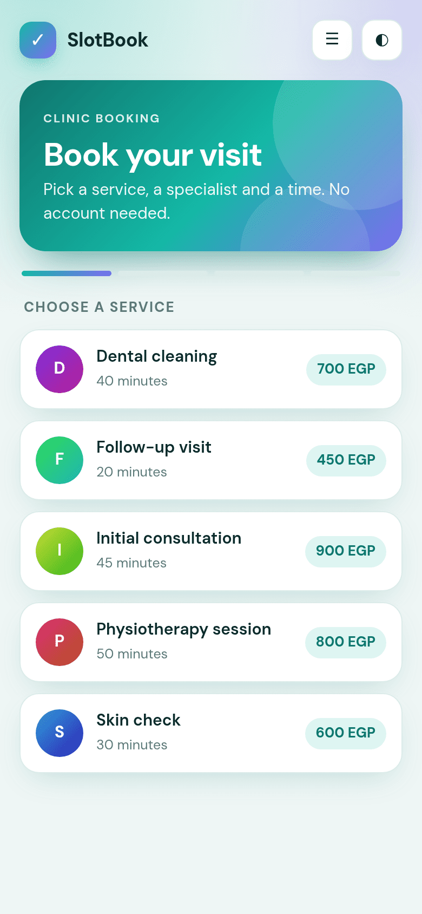
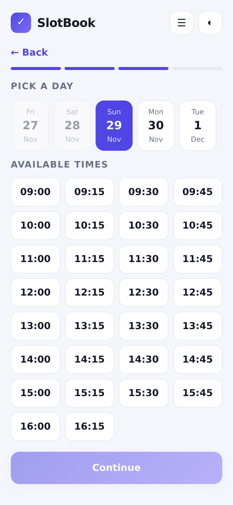
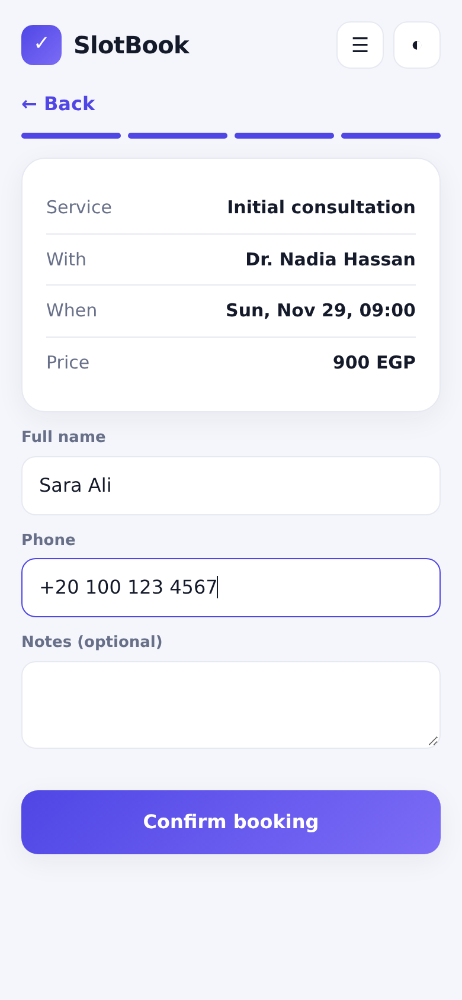
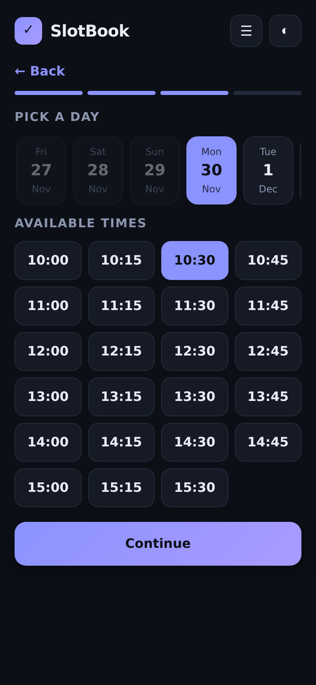
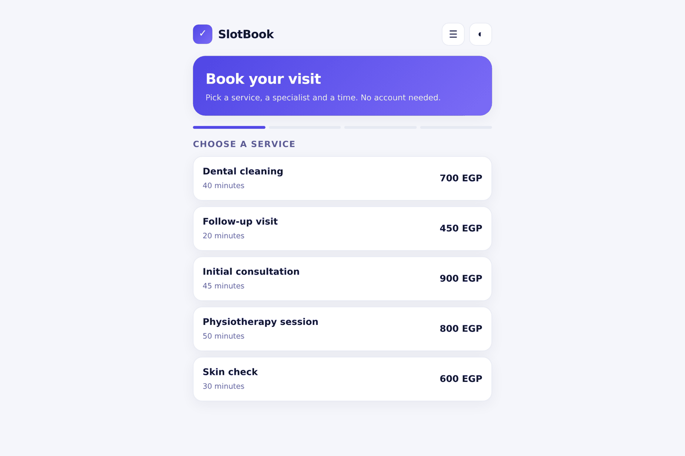

# SlotBook

Appointment booking service: a REST API and an installable, mobile-first web app. Clients choose a service, a specialist, a day and a time, and get a private reference they can use to look up or cancel the booking. No account needed. Zero npm dependencies (Node 22 built-ins and SQLite).

<p align="center">   </p>

## What it does

- Availability is computed from working hours, working days, service length, existing bookings and time off, on a 15 minute grid.
- Double booking is impossible: the overlap check and the insert run in one write transaction, and a test fires five simultaneous requests for one slot.
- Today's slots in the next 30 minutes are hidden; bookings open up to 60 days ahead.
- Cancelling is allowed up to 2 hours before the start, and frees the slot.
- Admin endpoints (list a day, mark completed or no-show, time off, stats) sit behind an `x-admin-key` header, compared in constant time.
- Per-IP rate limit on booking writes, request size limit, strict input validation.
- The web app works offline as a shell (service worker), can be added to a home screen, follows the system light or dark theme, and has a manual toggle.

## Run

```bash
npm run seed        # demo clinic data, http://localhost:3300
npm start           # empty database
npm test
```

Environment: `PORT`, `DB_FILE` (default `slotbook.db`), `ADMIN_KEY` (set it in production; the development default is `dev-admin-key`).

## API

| Method and path | Notes |
| --- | --- |
| `GET /api/services` | active services |
| `GET /api/providers?service=ID` | providers, optionally only those offering a service |
| `GET /api/availability?provider=&service=&date=YYYY-MM-DD` | `{slots, reason}`; reason is `closed`, `time_off`, `past`, `too_far` or `full` when empty |
| `POST /api/bookings` | `{provider_id, service_id, date, time, name, phone, notes?}` returns the booking and its token. 409 when the time is taken |
| `GET /api/bookings/:token`, `DELETE /api/bookings/:token` | look up or cancel |
| `GET /api/admin/bookings?date=`, `PATCH /api/admin/bookings/:id` | admin |
| `POST /api/admin/time-off`, `GET /api/admin/stats` | admin |

```bash
curl 'localhost:3300/api/availability?provider=1&service=1&date=2026-12-07'
curl -XPOST localhost:3300/api/bookings -H 'content-type: application/json' \
  -d '{"provider_id":1,"service_id":1,"date":"2026-12-07","time":"09:00","name":"Sara Ali","phone":"+20 100 123 4567"}'
```

## Layout

```
server/   http server and routes, SQLite schema, pure slot maths, demo seed
public/   web app (no build step), service worker, manifest, icon
test/     node:test suites for slot maths and the API
```



## Limits

Single clinic, single time zone (UTC on the server), no payments and no reminders. Demo names and data are fictional.
